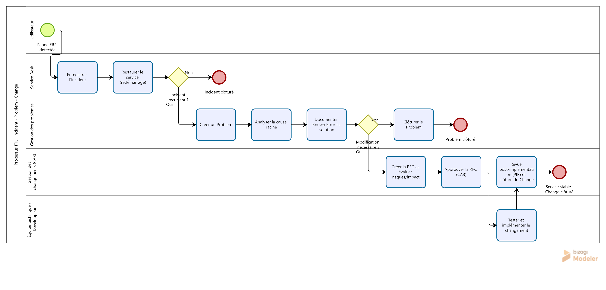

# ITIL | Incident, Problem & Change Management


---

## Overview

This project presents the modeling of an ITIL-based process covering Incident Management, Problem Management and Change Management.

The workflow illustrates the lifecycle of an ERP incident, from initial detection and service restoration to root cause analysis and, when required, the implementation of an approved change.

## Process Workflow

<p align="center">
  
</p>

## Process Architecture

The workflow is structured around five operational roles:

| Role | Responsibility |
|---|---|
| User | Detects and reports ERP incidents |
| Service Desk | Registers incidents and restores services |
| Problem Management | Investigates root causes and documents known errors |
| Change Advisory Board (CAB) | Evaluates and approves change requests |
| Technical Team | Tests and implements approved changes |

## Workflow Description

**01 — Incident Detection**

The user identifies an ERP failure and reports it to the Service Desk.

**02 — Incident Registration & Restoration**

The Service Desk records the incident and attempts to restore the service through a restart.

**03 — Problem Investigation**

If the incident is recurrent, a problem record is created. The root cause is analyzed and documented as a Known Error.

**04 — Change Evaluation**

If a modification is required, a Request for Change (RFC) is created, including risk and impact assessments.

**05 — Change Approval & Implementation**

The CAB reviews and approves the RFC. The technical team then tests and implements the approved change.

**06 — Post-Implementation Review**

A Post-Implementation Review (PIR) verifies service stability before the change is formally closed.

## Key ITIL Concepts

- Incident Management
- Problem Management
- Root Cause Analysis (RCA)
- Known Error Database (KEDB)
- Request for Change (RFC)
- Change Advisory Board (CAB)
- Post-Implementation Review (PIR)

## Tools & Standards

| Tool / Standard | Purpose |
|---|---|
| Bizagi Modeler | Process modeling |
| BPMN 2.0 | Workflow notation |
| ITIL | IT Service Management practices |
| Git & GitHub | Version control and project hosting |

## Repository Structure

```text
ITIL-Incident-Problem-Change/
│
├── Incident_Problem_Change.bpmn
├── Workflow.png
└── README.md
```

## Getting Started

Clone the repository:

```bash
git clone https://github.com/DRAISSI-Saad/ITIL-Incident-Problem-Change.git
```

Open the `.bpmn` file using a compatible BPMN modeling tool to explore the process.

---

## Author

**Saad Draissi**

Software Engineering | Web Development | Data Science

[GitHub Profile](https://github.com/DRAISSI-Saad)

---

<p align="center">
  <sub>Process Modeling · IT Service Management · BPMN 2.0</sub>
</p>
